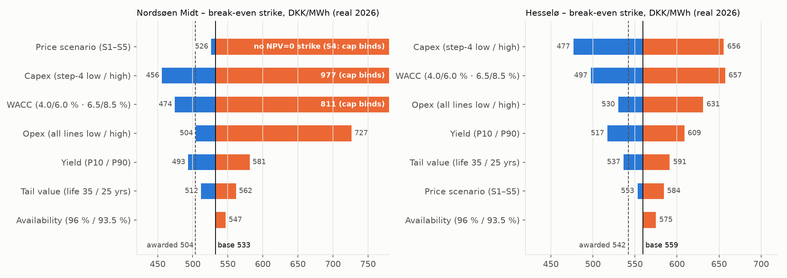
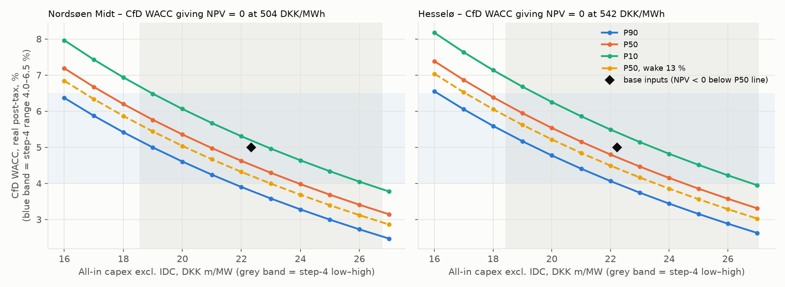

# What do Vattenfall's Danish offshore wind CfD bids imply?

In August 2026 Vattenfall won Denmark's two offshore wind tenders: Nordsøen Midt (1 GW, West Denmark) at DKK 504/MWh and Hesselø (0.8 GW, East Denmark) at DKK 542/MWh. This project asks what those prices imply about build cost, required return and wind output.

I rebuilt both bids from public data – the tender's contract terms, an hourly yield model, Danish power prices and the DEA's price outlook and cost data – in a monthly cash-flow model, then solved for the inputs that make the project break even at the awarded prices. Figures are in real 2026 DKK, valued at the bid date (20 May 2026). The step memos tag each input by source: tender documents, a named outside source, or my own assumption.

## Why I built this

Denmark's 2024 offshore wind tender got zero bids, and that made me question whether the wind market was somewhere I really wanted to build a career. When Vattenfall won both sites in 2026, I wanted to find out what it actually takes to evaluate an investment that size: what data goes in, how the numbers are worked through, and what drives a company to bid the price it does. I also used it to test whether I'd enjoy analyst or consultancy work. The finding that surprised me most was how much the bids seem to depend on next-generation 20 MW turbines.

With more time I'd run the full ERA5 dataset from Copernicus to check my wind data against it (the queue made even one month take hours), and look at what else could explain the bid: how the projects are financed, whether supply or offtake agreements sit behind them, and what strategic value Vattenfall sees in building a strong position in Danish offshore wind.

## Findings

In my base case the awarded prices are 3–6 % below break-even. Nordsøen Midt needs DKK 533/MWh against the 504 awarded, and Hesselø 559 against 542.

The gap closes if Vattenfall accepts a real after-tax return of about 4.5–4.7 % instead of my 5.0 %, builds for 4–6 % less than my estimate from DEA cost data (DKK 20.9–21.4m/MW instead of 22.3m), or gets a windier outcome than the median. A 4.5 % return is only about one percentage point above the 3.6–5.3 % real discount rate Vattenfall discloses for its wind business, which is thin compared with the 150–350 bp margins RWE and Ørsted say they target.

With the DEA's costs for today's 15 MW turbines, the implied return drops to 2.8–3.1 %, below Vattenfall's own rate. With costs and output for 20 MW turbines it rises to 4.8–5.0 %. My reading is that the bids rely on next-generation turbines.

The state's cap on CfD payments is the bigger difference between the two sites. Spread over 20 years it covers an average top-up of DKK 167/MWh at Nordsøen Midt but 313 at Hesselø. In a low power-to-X price scenario Nordsøen Midt's cap runs out in July 2047 and DKK 5.5bn of payments are never made, while Hesselø never uses more than 76 % of its cap. That may be part of why Nordsøen Midt drew two bids and Hesselø five, though that is my interpretation.

More detail: the [two-page memo](step5/bid_calibration_memo.md), the [one-page summary](summary/project1_summary.pdf) and the [source checks](step7/verification_notes.md).



*Break-even strike, one input at a time. Capex and the discount rate dominate; at NSM their high cases push the break-even into the net cap. Yield, tail value and availability are second-order.*



*Capex and CfD-period discount-rate combinations that give NPV = 0 at the awarded strikes, for P90 / P50 / P10 yield and a 13 % wake case. The base inputs (◆) sit above the P50 line, so NPV is negative at the base case.*

## Method

| Step | What it does | Read |
|---|---|---|
| 1. Contract terms | Turns the tender documents into model rules: settlement on Available Active Power (AAP), a monthly AAP-weighted reference price floored at 0, an NPI-indexed strike, a running net cap, and a one-month payment lag. | [contract_assumptions.md](contract_assumptions.md) |
| 2. Yield | ERA5 2006–2025 wind, quantile-mapped onto Energinet's LiDAR-based Weibull at 150 m, IEA 15 MW power curve, loss stack. Hourly AAP and metered output; AAP capacity factor 54.8 % (NSM) and 51.5 % (Hesselø). | [step2/](step2/README.md) · [yield_model.ipynb](step2/yield_model.ipynb) |
| 3. Prices | DK1/DK2 day-ahead prices 2016–2025 and the site reference price (capture ratio ≈ 0.88). 2033–2052 scenarios from DEA AF25 hourly prices, paired with site yield for the same weather year. | [step3/](step3/README.md) · [price_scenarios_method.md](step3/price_scenarios_method.md) · [price_analysis.ipynb](step3/price_analysis.ipynb) |
| 4. Costs, tax, discount rate | DEA Technology Data (FID-2030 column), site-adjusted for distance and depth; Energinet connection contribution; opex; Danish tax depreciation; discount-rate ranges from developer disclosures. | [step4/cost_assumptions.md](step4/cost_assumptions.md) |
| 5. DCF and calibration | Monthly CfD settlement with net cap and payment lag, tax pools on nominal cost deflated to real terms, separate CfD and merchant-tail discount rates, and solvers for the break-even strike and the NPV = 0 return and capex. | [bid_calibration_memo.md](step5/bid_calibration_memo.md) · [bid_calibration.ipynb](step5/bid_calibration.ipynb) |
| 7. Verification | Primary-source checks of the open inputs: Skatterådet's ruling on tax pools, the DEA's O&M definition, Vattenfall's 2025 impairment discount rates and the AF25 price notes. Two inputs corrected and step 5 re-run. | [verification_notes.md](step7/verification_notes.md) · [headline_check.py](step7/headline_check.py) |

## Data sources

| Source | Used for | Licence / terms | In this repo? |
|---|---|---|---|
| DEA tender documents for North Sea I South (Nordsøen Syd), Nov 2025: Annex F Concession Agreement, Appendix 3 and 3.1, Procurement Specifications; DEA *Step-by-Step Guide* (27 Mar 2026); Energinet draft Bilag 2.3 | Contract terms (step 1) | Tender material, no open licence | **No.** Cited by section number only |
| [DEA press release, 4 Aug 2026](https://via.ritzau.dk/pressemeddelelse/15074199/danmark-far-to-nye-havvindmolleparker?lang=da) | Awarded strikes and bid counts | – | Link only |
| ERA5 (Hersbach et al., C3S) via [Open-Meteo](https://open-meteo.com/) | Hourly wind, 1995 and 2006–2025 | CC BY 4.0 | Recreated by `step2/era5_openmeteo.py` |
| Energinet site wind assessments (C2Wind, North Sea I, rev. 3; EMD, Hesselø South, rev. 3) | Long-term wind level and shape at 150 m | Energinet site data | Values cited only |
| IEA 15 MW reference turbine, from NREL's `turbine-models` repository | Power curve | See the source repository | `step2/data/IEA_Reference_15MW_240.csv` |
| [Energi Data Service](https://www.energidataservice.dk/) (Energinet) | DK1/DK2 day-ahead prices, metered wind | CC BY 4.0 | Recreated by `step3/eds_price_download.py` |
| Skatterådet binding answer SKM2025.37.SR (19 Nov 2024), retsinformation.dk | Tax pools for cables, substations, foundations, Energinet contribution | Public | Cited |
| Vattenfall Annual and Sustainability Report 2025, Note 27 | Discount rates for the wind business (comparison only) | Company report | Values cited |
| [DEA Technology Data, generation of electricity and district heating](https://ens.dk/en/analyses-and-statistics/technology-data-generation-electricity-and-district-heating), workbook v0019, sheet "21 Offshore Wind AC Fixed" | Capex and O&M | CC BY 4.0 | Extracted rows only (`step4/outputs/`, `step4/dea_offshore_ac_2030.yaml`) |
| [DEA Analysis Assumptions for Energinet 2025 (AF25)](https://ens.dk/analyser-og-statistik/analyseforudsaetninger-til-energinet), [price dataset](https://ens.dk/media/7632/download) | 2033–2052 price scenarios | DEA publication | **No.** Download manually (see below) |
| Statistics Denmark PRIS04 (net price index) | Price base and strike indexation | Statistics Denmark terms (attribution) | Index values quoted |
| Energinet tariff catalogue 2026; Afskrivningsloven, Selskabsskatteloven | Connection contribution, producer tariffs, tax | Public | Cited |

## How to run

Windows, PowerShell, Python 3.13. Run from the repo root unless a step says otherwise.

```powershell
git clone https://github.com/fergal567/danish-offshore-cfd-bid-model.git
cd danish-offshore-cfd-bid-model
py -3.13 -m venv .venv
.\.venv\Scripts\Activate.ps1
python -m pip install -r requirements.txt
```

If PowerShell blocks the activation script, run `Set-ExecutionPolicy -Scope CurrentUser RemoteSigned` once.

**Manual downloads** (third-party files that are not redistributed here):

| File | Save as | Needed for |
|---|---|---|
| [AF25 – datasæt – elprisfremskrivning](https://ens.dk/media/7632/download) | `step5/data/AF25 - datasæt - elprisfremskrivning.xlsx` | Step 5 price scenarios |
| [DEA Technology Data workbook](https://ens.dk/en/analyses-and-statistics/technology-data-generation-electricity-and-district-heating) (v0019) | `step4/data/technology_data_for_el_and_dh_-_0019.xlsx` | Only to rebuild step 4. `step4/cost_inputs.yaml` is committed, so step 5 runs without it |

**Run order:** step 2 → step 3 → step 4 → step 5. Each step writes the files the next one reads.

| Step | Commands | Recreates (git-ignored) | Time |
|---|---|---|---|
| 2 | `cd step2`, then `python era5_openmeteo.py --extra-years 1995`, then `jupyter nbconvert --to notebook --execute --inplace yield_model.ipynb`, then `cd ..` | `step2/data/era5_*.csv`, `step2/data/aap_hourly_*.csv` | ≈ 5 min download, no API key |
| 3 | `cd step3`, then `python eds_price_download.py --start 2016 --end 2025 --wind`, then `jupyter nbconvert --to notebook --execute --inplace price_analysis.ipynb`, then `cd ..` | `step3/data/` (raw cache and reference-price outputs) | ≈ 1 min |
| 4 | Optional, from the repo root: `python step4\dea_extract.py "step4\data\technology_data_for_el_and_dh_-_0019.xlsx" --sheet "21 Offshore Wind AC Fixed" --year 2030`, then `python step4\build_cost_inputs.py` | `step4/outputs/dea_*.csv`, `step4/cost_inputs.yaml`, `step4/outputs/cost_table.md` (all committed) | seconds |
| 5 | `python step5/reconstruct_aap_1995.py`, then `cd step5`, then `jupyter nbconvert --to notebook --execute --inplace bid_calibration.ipynb`, then `cd ..` | `step5/data/aap_hourly_1995_*.csv`, `step5/outputs/` | ≈ 2–3 min |

**Tests** (45 in total; integration tests skip themselves when their data files are missing):

```powershell
python -m pytest step3/tests -q
python -m pytest step4/tests -q
python -m pytest step5/tests -q
```

## Repo layout

```
danish-offshore-cfd-bid-model/
├── README.md
├── LICENSE
├── requirements.txt
├── contract_assumptions.md        # Step 1: CfD terms, tagged Doc / Ext / Asm
├── summary/                       # One-page PDF (LaTeX), figure and LinkedIn carousel scripts
├── step2/                         # Yield model
│   ├── README.md
│   ├── era5_openmeteo.py          # ERA5 via Open-Meteo (used)
│   ├── era5_download.py           # Copernicus CDS fallback
│   ├── yield_model.ipynb
│   ├── data/IEA_Reference_15MW_240.csv
│   └── outputs/                   # yield_annual_summary.csv, yield_config.json
├── step3/                         # Prices and CfD reference price
│   ├── README.md
│   ├── eds_price_download.py
│   ├── price_analysis.ipynb
│   ├── price_scenarios_method.md
│   └── tests/
├── step4/                         # Cost, tax and discount-rate inputs
│   ├── README.md
│   ├── cost_assumptions.md        # Memo
│   ├── dea_extract.py             # DEA workbook → dea_offshore_ac_2030.yaml
│   ├── dea_offshore_ac_2030.yaml
│   ├── build_cost_inputs.py       # → cost_inputs.yaml
│   ├── cost_inputs.yaml           # Read by step 5
│   ├── outputs/                   # cost_table.md, DEA sheet extract
│   └── tests/
└── step5/                         # DCF and bid calibration
    ├── README.md
    ├── bid_calibration_memo.md    # Headline findings
    ├── dcf_model.py
    ├── reconstruct_aap_1995.py
    ├── bid_calibration.ipynb
    ├── outputs/                   # Result CSVs and charts
    └── tests/
└── step7/                         # Primary-source verification
    ├── verification_notes.md
    └── headline_check.py          # Prints the headline numbers and the step-7 effects
```

## Limitations and open items

- The contract terms come from the Nordsøen Syd tender documents, used as a proxy because Nordsøen Midt's and Hesselø's own Annex F and Appendix 3 weren't available. The cap amounts come from the DEA guide (Nordsøen Midt) and the EU contract notice (Hesselø).
- The DEA's price outlook uses weather years 1995, 2008 and 2009. Site output for 1995 is rebuilt from ERA5 wind with the step-2 wind-to-output relationship (held-out R² 0.998 and 0.991), not run through the step-2 notebook.
- My site capture factors (0.84–0.91 within each month) are well above the DEA's published fleet ratios (0.57 / 0.95 / 0.76 for DK1 in 2030 / 2040 / 2050), and the DEA doesn't document how it builds them. I run the DEA ratio as a downside, which lifts Nordsøen Midt's break-even to DKK 606/MWh.
- Tax pools follow one binding ruling (SKM2025.37.SR), which puts cables and transformer stations at 7 % without naming each asset. Applying it to array cables, export cable and offshore substation is my reading.
- Capex is adjusted to each site by interpolating between DEA datasheets, not with the formulas in the DEA's chapter text. Hesselø has no premium for nature-inclusive design, and its grid-connection charge depends on an area classification I couldn't confirm (DKK 157–532m). Insurance is taken as part of DEA fixed O&M, per the DEA's general guideline.
- Vattenfall's disclosed discount rate covers its whole wind business, on- and offshore, and doesn't say nominal or real. I read it as nominal.
- Overplanting isn't in the base case. The DEA's outlook assumes it at both sites, so it is another possible lever behind the bids.
- This is an outside-in reconstruction from public information. It isn't affiliated with Vattenfall, the DEA or Energinet and doesn't claim to match Vattenfall's own inputs.

## About

Fergal Israel. I'm an MSc Wind Energy student at DTU (2026–2028) with a BEng in Mechanical Engineering from Swansea, interested in the commercial side of offshore wind. This is an independent project, not part of my coursework.

Code is released under the [MIT licence](LICENSE). Data and values from third parties keep their own licences, listed above.
